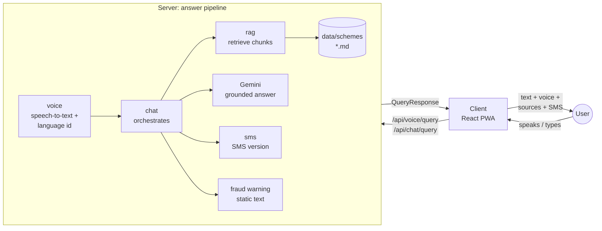

# Architecture

## Big picture



1. The user speaks (push-to-talk) or types, in Hindi, Marathi, Tamil, English or a dialect.
2. **voice** turns audio into text and detects the language in one Gemini call.
3. **chat** runs the pipeline: **rag** finds the most relevant chunks of the official scheme
   documents in `data/schemes/`, Gemini writes an answer **only from those chunks** in the
   user's language, **sms** produces an SMS-length version and a static fraud warning is attached.
4. The client shows the answer with source cards and the fraud warning, reads it aloud
   (browser speech synthesis by default) and can preview the SMS on a feature-phone mockup.
5. If the documents do not answer the question, the API returns `notFound: true` and tells the
   user where to ask instead. It never guesses.

Side flows: the **eligibility** wizard asks a few questions and evaluates deterministic rules
from `data/eligibility/`, and **faq** serves pre-generated answers to the top questions that
low-bandwidth clients keep for offline use.

## The answer pipeline

```
  spoken question                                 typed question
  POST /api/voice/query (audio)                   POST /api/chat/query (text)
          |                                                |
          v                                                |
  [voice] Gemini: audio in, JSON out                       |
          { transcript, detectedLanguage }                 |
          dialect (bho, awa, ...) -> hi / mr / ta / en     |
          |                                                v
          |                       [chat] language from script + marker words (no AI)
          +-------------------------+----------------------+
                                    v
          answer cache: LRU + TTL, key = language + normalized question
                 | hit ------------------------------------> response (usedCache: true)
                 v miss (identical questions in flight share one run)
  [rag]   optional: translate the question to English (RAG_TRANSLATE_QUERY)
          embed it with the knowledge base's model (Gemini embeddings)
          cosine similarity against every chunk in memory -> top RAG_TOP_K
                 |
          any chunk with score >= RAG_MIN_SCORE? --no--> notFound: fixed, reviewed text
                 | yes                                   "not in the documents, confirm at
                 v                                        your nearest CSC / gram panchayat"
  [chat]  Gemini: passages + question in, JSON { answer, usedChunkIds } out
          (only the passages; user's language; simple spoken words; short
          sentences; scheme name; never invent amounts, dates or eligibility)
                 |
          usedChunkIds empty? --yes--> notFound: fixed text (as above)
                 | no
                 v
          sources      = the passages listed in usedChunkIds
          fraudWarning = static text per language (never model output)
                 |
  [sms]   fits SMS_MAX_SEGMENTS? --yes--> as it is
                 | no
                 v
          Gemini rewrite under a character budget --fails / too long--> keep whole sentences
                 |
                 v
          QueryResponse --> client: text, source cards, read aloud, SMS preview

  Before deploying (offline):
    data/schemes/*.md|.txt|.pdf --npm run ingest--> sections -> ~600-token chunks (80 overlap)
        --> Gemini embeddings (batched, retried) --> server/data/vectorstore.json
    data/faq/questions.json --npm run prewarm--> server/data/faq.json
        (GET /api/faq/top, and seeds the answer cache)
```

## The eligibility wizard

```
  POST /api/eligibility/start  -> first useful question from data/eligibility/questions.json
  POST /api/eligibility/answer:
     answer: number / true-false / option label / plain yes-no word? --yes--> value (no AI)
                 | no: free-form, e.g. "do bigha zameen", "main kisaan hu"
                 v
             Gemini reads the value (JSON) --cannot--> 422 UNCLEAR_ANSWER, same question again
                 |
                 v
     every scheme's conditions, three-valued (yes / no / not known yet), plain code, no AI
                 |
     a scheme still undecided? --yes--> next question that can change it (the rest are skipped)
                 | no
                 v
     results: eligible first; reason = text of the condition that failed, in the user's language
```

Gemini only translates texts that have no reviewed translation and reads free-form answers;
it never decides eligibility.

## Repository layout

| Path            | What                                                                           |
| --------------- | ------------------------------------------------------------------------------ |
| `shared/src/`   | API contract types (types only, no runtime code, no build step)                |
| `server/src/`   | Express API: one folder per module in `modules/`                               |
| `client/src/`   | React app: one folder per feature in `features/`                               |
| `data/schemes/` | Source documents for retrieval (Markdown + front matter)                       |
| `docs/`         | This file, the [API contract](API_CONTRACT.md) and the [workstreams](TASKS.md) |

## Server

```
server/src/
  index.ts            loads data (startup.ts), then starts the HTTP server (dev, npm start)
  app.ts              the app as a default export, without listen(): the entry on Vercel
  createApp.ts        middleware + one router per module, mounted under /api
  startup.ts          loads the knowledge base, FAQ and rules; warns about missing / stale data
  config/env.ts       .env loading and zod validation (fails fast on bad values)
  modules/<name>/     routes.ts -> controller.ts -> service.ts (+ prompts.ts for AI modules)
    rag/              documents, chunking, vectorStore, prompts, service
    eligibility/      rules (format), engine (evaluation), answers, localize, prompts, service
  middleware/         errorHandler (one error format), requestLogger, upload (multer)
  lib/                geminiClient, cache (LRU), languages, vectors, logger, httpError, validation
  mocks/              mock data (mirrored in client/src/mocks)
server/scripts/       ingest.ts, prewarm.ts, query.ts (npm run ingest | prewarm | query)
server/test/          vitest unit tests (npm test -w server)
server/data/          generated: vectorstore.json, faq.json (commit them for deploys)
```

Each module has the same three layers:

- **routes.ts**: paths and middleware only.
- **controller.ts**: HTTP. Validates the request with zod, types the response with the contract
  type, calls the service. No business logic.
- **service.ts**: the logic, as plain async functions that other modules can call
  (`chat` calls `rag.searchSchemes` and `sms.countSmsSegments`; `voice` calls
  `chat.answerQuestion`).

Every service decides between mock and real at the top:

```ts
if (isMocked('rag')) return mockSearchSchemes(input.query, topK).map(fromMockChunk);
// real implementation follows
```

All AI calls go through `lib/geminiClient.ts` (`@google/genai`): structured JSON generation with
a zod schema (`generateJson`) and batched embeddings (`embedTexts`). It owns timeouts, retries
with exponential backoff and jitter on 429 / 5xx / timeouts / network errors (honouring the wait
Gemini asks for), and typed `GeminiError`s that become `429 AI_RATE_LIMITED`, `502 AI_ERROR`,
`503 AI_NOT_CONFIGURED | AI_UNAVAILABLE` or `504 AI_TIMEOUT`. Tests swap in a fake backend with
`setGeminiBackend`. Prompts live in the module that owns them (`prompts.ts`).

### Mock mode

- `USE_MOCKS=true` (default): every module serves mock data, with no API key needed.
- `USE_MOCKS=false`: everything real. Needs `GEMINI_API_KEY`, the knowledge base
  (`npm run ingest -w server`) and, for `/api/faq/top`, the FAQ (`npm run prewarm -w server`).
  Without them the endpoints answer 503 with the command to run; the eligibility wizard works
  without AI as long as answers are exact values or plain yes / no words.
- `USE_MOCKS=eligibility,sms`: **only the listed modules** stay mocked. This lets one workstream
  switch its own module to the real implementation while the others keep working.
  Module names: `voice, chat, rag, eligibility, sms, tts, faq`.
- `VITE_USE_MOCKS=true`: the browser answers from `client/src/mocks` and never calls the server
  (frontend-only work or a static demo deploy). The mock files `query.ts`, `eligibility.ts` and
  `faq.ts` are identical copies in `server/src/mocks` and `client/src/mocks`.

Logic that needs no AI: text language detection, retrieval scoring and the relevance gate, the
eligibility rules, SMS segment counting and the sentence-boundary fallback, the answer cache.

## Client

```
client/src/
  app/              shell: App, router, providers, Layout (header + bottom nav)
  features/<name>/  screens and components of one feature, its strings.ts, its hooks
  components/ui/    Button, Card, Badge, Spinner, Toast
  lib/              api.ts (typed client), config.ts, i18n.ts, settings.ts, storage.ts
  mocks/            in-browser API used when VITE_USE_MOCKS=true
```

- **Screens:** `/` chat (voice + text), `/eligibility` wizard, `/sms` SMS preview, low-bandwidth
  mode and offline FAQ. On screens 1024 px and wider (laptops, projectors) the app sits in a phone
  frame next to a pitch panel (`app/Showcase.tsx`); phones get the app full screen.
- **Look:** colour tokens (`brand` green, `marigold` accent, `cream` paper) and animations live in
  `src/index.css` (`@theme`); change them there to re-theme everything. Motion respects
  `prefers-reduced-motion`.
- **State:** `SettingsContext` (language, low-bandwidth mode, session id; saved in localStorage),
  `ChatContext` (the conversation; survives switching screens), `ToastContext`.
- **API:** components never call `fetch`; they use `api` from `lib/api.ts`, which is typed with
  the contract and switches to the mocks when `VITE_USE_MOCKS=true`.
- **Translations:** each feature has a `strings.ts` with the four languages
  (`Strings<typeof en>` makes the build fail if a key is missing). Use
  `const t = useStrings(myStrings)`. Answers come from the API already translated.
- **Accessibility for low-literacy users:** big touch targets (48 px or more), icons with every
  label, language names in their own script, read-aloud buttons, high contrast, and system fonts
  only (no font download).
- **Low-bandwidth mode:** text first, no server audio, top answers cached on the device. The
  service worker and offline shell come in step 3.

## Configuration

One `.env` at the repo root (template: `.env.example`) feeds both apps; an optional
`server/.env` overrides it for the server, and real environment variables override both. The
server reads all variables; Vite exposes only `VITE_*` variables to the browser, so **secrets
must never use the `VITE_` prefix**. In dev, Vite proxies `/api` to the server port, so the
client needs no `VITE_API_URL` and the server needs no CORS setup. If the client is served from
another origin, set `VITE_API_URL` on the client and add the client's URL to `CLIENT_ORIGIN`.

Every variable (validated in `server/src/config/env.ts`; an empty value means "use the default"):

| Variable                  | Default                                       | What it does                                                                                             |
| ------------------------- | --------------------------------------------- | -------------------------------------------------------------------------------------------------------- |
| `NODE_ENV`                | `development`                                 | `production` lowers the default log level to `info`; `test` skips `.env` files                           |
| `PORT`                    | `4000`                                        | HTTP port of the API (and the target of the Vite dev proxy)                                              |
| `USE_MOCKS`               | `true`                                        | `true`, `false`, or the modules that stay mocked: `voice, chat, rag, eligibility, sms, tts, faq`         |
| `CLIENT_ORIGIN`           | `http://localhost:5173`                       | Origins allowed by CORS, comma-separated                                                                 |
| `LOG_LEVEL`               | `debug` (dev), `info` (prod), `error` (tests) | `debug`, `info`, `warn` or `error`; debug shows each Gemini call with timings and token counts           |
| `GEMINI_API_KEY`          | none                                          | Google AI Studio key. Needed for every real AI call; server only                                         |
| `GEMINI_CHAT_MODEL`       | `gemini-3.8-flash`                            | Answers, SMS rewrite, eligibility answer reading and translation, query translation                      |
| `GEMINI_AUDIO_MODEL`      | `GEMINI_CHAT_MODEL`                           | Speech-to-text and language identification                                                               |
| `GEMINI_EMBED_MODEL`      | `gemini-embedding-2`                          | Embedding model used by `npm run ingest`; queries always use the model the knowledge base was built with |
| `GEMINI_EMBED_DIMENSIONS` | `768`                                         | Embedding size for ingestion (128–3072)                                                                  |
| `GEMINI_THINKING_LEVEL`   | `low`                                         | `minimal`, `low`, `medium`, `high`, or `default` (let the model decide). Higher = slower, more careful   |
| `GEMINI_TIMEOUT_MS`       | `30000`                                       | Timeout per Gemini call                                                                                  |
| `GEMINI_MAX_RETRIES`      | `3`                                           | Retries on rate limits, 5xx, timeouts and network errors (0–8)                                           |
| `RAG_TOP_K`               | `4`                                           | Chunks retrieved per question (1–10)                                                                     |
| `RAG_MIN_SCORE`           | `0.5`                                         | Cosine similarity a chunk needs to be used; none left means `notFound`. Calibrate with `npm run query`   |
| `RAG_TRANSLATE_QUERY`     | `false`                                       | Translate non-English questions to English before embedding (one extra Gemini call)                      |
| `CACHE_MAX_ENTRIES`       | `500`                                         | Answers kept in the in-memory cache; `0` disables it                                                     |
| `CACHE_TTL_MINUTES`       | `360`                                         | How long a cached answer lives; `0` = until evicted                                                      |
| `SMS_MAX_SEGMENTS`        | `2`                                           | SMS length limit in segments (1–10)                                                                      |
| `RATE_LIMIT_PER_MINUTE`   | `30`                                          | Requests per minute per IP to the AI endpoints (voice, chat, rag, eligibility, sms); `0` = no limit      |
| `TRUST_PROXY`             | `1`                                           | Proxy hops in front of the server, so the limit sees the real client IP (1 on Vercel)                    |
| `VITE_API_URL`            | empty (same origin)                           | Client: API origin, e.g. when the API runs on another domain                                             |
| `VITE_USE_MOCKS`          | `false`                                       | Client: answer from `client/src/mocks` in the browser and never call the server                          |

Model defaults follow the Gemini API docs at the time of writing
([models](https://ai.google.dev/gemini-api/docs/models),
[embeddings](https://ai.google.dev/gemini-api/docs/embeddings)); they are plain strings, so
switching models is a config change. Changing the embedding model or size needs a new
`npm run ingest`.

## Roadmap and TODO markers

| Step | Scope                                                                                                                                                                                                                    | Marker         |
| ---- | ------------------------------------------------------------------------------------------------------------------------------------------------------------------------------------------------------------------------ | -------------- |
| 1    | This skeleton: contract, mocks, UI, tooling                                                                                                                                                                              | (done)         |
| 2    | Server (done): Gemini speech-to-text + language detection, retrieval over in-memory embeddings, grounded answers, SMS compression, eligibility rules from data, FAQ prewarm. Client: real mic recording, new error codes | `TODO(step-2)` |
| 3    | Vector DB for embeddings, semantic answer cache, server TTS, PWA (service worker, offline shell), deployment hardening                                                                                                   | `TODO(step-3)` |

Find the work: `git grep -n "TODO(step-2)"` (or `step-3`).

## Design decisions

- **Contract first, mocks everywhere.** Every workstream can build against realistic data from
  hour 0, and integration is a config switch instead of a merge marathon.
- **Types-only `shared` package.** Both apps import it with `import type`, so it is erased at
  build time: no build step, no bundling of a workspace package into the server. An ESLint rule
  keeps runtime code out of it. Runtime lists such as language codes live in each app, typed as
  `Record<LanguageCode, ...>` so they cannot drift from the contract.
- **CommonJS server compiled by `tsc`.** Relative imports need no file extensions, `tsx`
  runs it in dev and `node dist/index.js` in production.
- **No vector database (yet).** A few thousand chunks fit in memory and brute-force cosine
  similarity takes milliseconds, so the knowledge base is one JSON file built by
  `npm run ingest` and loaded at startup. Each query is embedded with the same model and size
  as the stored chunks.
- **Structured output everywhere.** Every Gemini call returns JSON checked against a zod schema
  (e.g. the answer must cite passage ids that were actually sent), so the code never parses
  free text.
- **Grounded or nothing.** Answers cite their sources; with no relevant source the API says
  `notFound` instead of guessing. The fraud warning is static text, never model output.
- **Deterministic eligibility.** Rules are data (`data/eligibility/`) evaluated by plain code,
  never an LLM: the same answers always give the same result. Gemini only translates missing
  texts and reads free-form answers into values.
- **Built for basic phones.** SMS output respects segment limits (Indic scripts use Unicode SMS:
  70 characters, or 67 per part), and low-bandwidth mode keeps answers available offline.
