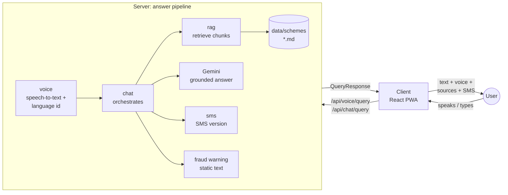

# Architecture

## Big picture



1. The user speaks (push-to-talk) or types, in Hindi, Marathi, Tamil, English or a dialect.
2. **voice** turns audio into text and detects the language (Gemini audio input, step 2).
3. **chat** runs the pipeline: **rag** finds the most relevant chunks of the official scheme
   documents in `data/schemes/`, Gemini writes an answer **only from those chunks** in the
   user's language, **sms** produces an SMS-length version and a static fraud warning is attached.
4. The client shows the answer with source cards and the fraud warning, reads it aloud
   (browser speech synthesis by default) and can preview the SMS on a feature-phone mockup.
5. If the documents do not answer the question, the API returns `notFound: true` and tells the
   user where to ask instead. It never guesses.

Side flows: the **eligibility** wizard asks 3–4 questions and evaluates deterministic rules,
and **faq** serves a small list of top questions that low-bandwidth clients keep for offline use.

## Repository layout

| Path            | What                                                                           |
| --------------- | ------------------------------------------------------------------------------ |
| `shared/src/`   | API contract types (types only, no runtime code, no build step)                |
| `server/src/`   | Express API: one folder per module in `modules/`                               |
| `client/src/`   | React app: one folder per feature in `features/`                               |
| `data/schemes/` | Source documents for retrieval (Markdown + front matter)                       |
| `docs/`         | This file, the [API contract](API_CONTRACT.md) and the [workstreams](TASKS.md) |

## Server

```
server/src/
  index.ts            starts the HTTP server (env is loaded first)
  app.ts              middleware + one router per module, mounted under /api
  config/env.ts       .env loading and zod validation (fails fast on bad values)
  modules/<name>/     routes.ts -> controller.ts -> service.ts
  middleware/         errorHandler (one error format), requestLogger, upload (multer)
  lib/                geminiClient (stub), cache, logger, httpError, validation
  mocks/              mock data (mirrored in client/src/mocks)
```

Each module has the same three layers:

- **routes.ts**: paths and middleware only.
- **controller.ts**: HTTP. Validates the request with zod, types the response with the contract
  type, calls the service. No business logic.
- **service.ts**: the logic, as plain async functions that other modules can call
  (`chat` calls `rag.searchSchemes` and `sms.countSmsSegments`; `voice` calls
  `chat.answerQuestion`).

Every service decides between mock and real at the top:

```ts
if (isMocked('rag')) return mockSearchSchemes(input.query, topK);
// TODO(step-2): real implementation
throw new NotImplementedError('rag.searchSchemes'); // -> 501 NOT_IMPLEMENTED
```

All AI calls go through `lib/geminiClient.ts`, so models, retries and rate limits live in one
place. Prompts live in the module that owns them.

### Mock mode

- `USE_MOCKS=true` (default): every module serves mock data, with no API key needed.
- `USE_MOCKS=false`: everything real (unfinished parts return 501).
- `USE_MOCKS=eligibility,sms`: **only the listed modules** stay mocked. This lets one workstream
  switch its own module to the real implementation while the others keep working.
  Module names: `voice, chat, rag, eligibility, sms, tts, faq`.
- `VITE_USE_MOCKS=true`: the browser answers from `client/src/mocks` and never calls the server
  (frontend-only work or a static demo deploy). The mock files `query.ts`, `eligibility.ts` and
  `faq.ts` are identical copies in `server/src/mocks` and `client/src/mocks`.

Real logic that needs no AI already exists: SMS segment counting (GSM-7 vs Unicode), the
eligibility wizard state machine and answer validation, and the answer cache.

## Client

```
client/src/
  app/              shell: App, router, providers, Layout (header + bottom nav)
  features/<name>/  screens and components of one feature, its strings.ts, its hooks
  components/ui/    Button, Card, Badge, Spinner, Toast
  lib/              api.ts (typed client), config.ts, i18n.ts, settings.ts, storage.ts
  mocks/            in-browser API used when VITE_USE_MOCKS=true
```

- **Screens:** `/` chat (voice + text), `/eligibility` wizard, `/sms` SMS preview, low-bandwidth
  mode and offline FAQ.
- **State:** `SettingsContext` (language, low-bandwidth mode, session id; saved in localStorage),
  `ChatContext` (the conversation; survives switching screens), `ToastContext`.
- **API:** components never call `fetch`; they use `api` from `lib/api.ts`, which is typed with
  the contract and switches to the mocks when `VITE_USE_MOCKS=true`.
- **Translations:** each feature has a `strings.ts` with the four languages
  (`Strings<typeof en>` makes the build fail if a key is missing). Use
  `const t = useStrings(myStrings)`. Answers come from the API already translated.
- **Accessibility for low-literacy users:** big touch targets (48 px or more), icons with every
  label, language names in their own script, read-aloud buttons, high contrast, and system fonts
  only (no font download).
- **Low-bandwidth mode:** text first, no server audio, top answers cached on the device. The
  service worker and offline shell come in step 3.

## Configuration

One `.env` at the repo root (template: `.env.example`) feeds both apps. The server reads all
variables; Vite exposes only `VITE_*` variables to the browser, so **secrets must never use the
`VITE_` prefix**. In dev, Vite proxies `/api` to the server port, so the client needs no
`VITE_API_URL` and the server needs no CORS setup. In production set `VITE_API_URL` on the client
and add the client's URL to `CLIENT_ORIGIN` on the server.

## Roadmap and TODO markers

| Step | Scope                                                                                                                                                                                                            | Marker         |
| ---- | ---------------------------------------------------------------------------------------------------------------------------------------------------------------------------------------------------------------- | -------------- |
| 1    | This skeleton: contract, mocks, UI, tooling                                                                                                                                                                      | (done)         |
| 2    | Real logic with Gemini: speech-to-text + language detection, grounded answers, SMS compression, real mic recording, retrieval over `data/schemes` (keyword or in-memory embeddings), eligibility rules from data | `TODO(step-2)` |
| 3    | Vector DB for embeddings, semantic answer cache, PWA (service worker, offline shell), deployment hardening                                                                                                       | `TODO(step-3)` |

Find the work: `git grep -n "TODO(step-2)"` (or `step-3`).

## Design decisions

- **Contract first, mocks everywhere.** Every workstream can build against realistic data from
  hour 0, and integration is a config switch instead of a merge marathon.
- **Types-only `shared` package.** Both apps import it with `import type`, so it is erased at
  build time: no build step, no bundling of a workspace package into the server. An ESLint rule
  keeps runtime code out of it. Runtime lists such as language codes live in each app, typed as
  `Record<LanguageCode, ...>` so they cannot drift from the contract.
- **CommonJS server compiled by `tsc`.** Relative imports need no file extensions, `tsx`
  runs it in dev and `node dist/index.js` in production.
- **Grounded or nothing.** Answers cite their sources; with no relevant source the API says
  `notFound` instead of guessing. The fraud warning is static text, never model output.
- **Deterministic eligibility.** Rules are code or data, never an LLM: the same answers must
  always give the same result. Gemini may only phrase the reasons.
- **Built for basic phones.** SMS output respects segment limits (Indic scripts use Unicode SMS:
  70 characters, or 67 per part), and low-bandwidth mode keeps answers available offline.
